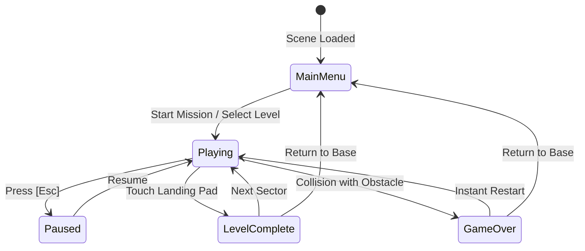

# Rocket Boost 🚀

[](https://unity.com/)
[](https://unity.com/srp/universal-render-pipeline)
[](Assets/Tests/EditMode)
[](docs/ARCHITECTURE.md)
[](Assets/CREDITS.md)

An arcade precision physics flight game built in **Unity 6 (6000.0.34f1)** with Universal Render Pipeline (URP). Pilot a high-thrust rocket through three challenging sectors of kinetic obstacles, manage momentum and fuel-free thrust vectors, stick precision pad landings, and shatter sector time records.

Engineered with **Clean Architecture** principles: a strictly decoupled, pure C# domain layer (`noEngineReferences: true`) with **62 automated EditMode unit tests**, an idempotent procedural sci-fi UI design system, an event-driven session finite state machine, and zero-allocation HUD performance.

---

## 🎮 Play & Demo

- **Platforms:** Windows Standalone (x86_64) | WebGL (Browser)
- **Engine Version:** Unity 6000.0.34f1 (URP)
- **Play Online:** *(Add your WebGL itch.io / GitHub Pages link here)*

---

## ✨ Key Features

### 🕹️ Physics & Core Gameplay
- **Momentum-Based Flight:** Dual-thruster rotational torque and main vector propulsion with tuned inertial damping.
- **Dynamic Kinetic Hazards:** Oscillating barriers, rotating hazard gates, and kinetic death zones built with kinematic physics and DOTween integration.
- **Precision Landing Detection:** Contact angle and speed verification on dedicated launch pads and landing pads.
- **Record & Ranking System:** Microsecond-accurate mission timer with dynamic S/A/B/C rank tier evaluations based on completion time and attempt count.

### 📐 Engineering & Architecture
- **Strict Domain Layering:** Game rules, timer arithmetic, rank calculations, and progression logic live in `RocketBoost.Core` without any `UnityEngine` dependency.
- **62 Automated EditMode Tests:** Comprehensive unit test coverage for float truncation, culture-invariant time formatting, rank boundary cases, and best-time store persistence.
- **Repository Seam for Persistence:** High scores persist via an `IKeyValueStore` abstraction (`PlayerPrefsKeyValueStore`), making cloud or file-based save swaps trivial.
- **Robust Session State Machine:** Centralized `GameManager` enforces clean transitions across `MainMenu`, `Playing`, `Paused`, `LevelComplete`, and `GameOver`, preventing double-collision race conditions and timescale freezes.
- **Domain Reload Optimization:** Built for zero-reload fast playmode iteration (*Enter Play Mode Options: Domain Reload Disabled*) with explicit static lifecycle resets.
- **Zero-Allocation Hot Paths:** HUD timer avoids per-frame string allocations via TextMeshPro char-buffer formatting.

### 🎨 Custom Sci-Fi UI System & Automation Pipeline
- **Theme-Driven Design System:** Single ScriptableObject (`UITheme.asset`) controls color palette, fonts (Orbitron / Rajdhani), spacing scales, corner radii, and UI audio stings.
- **Idempotent Editor Builder:** One-click menu tool (`Rocket Boost → UI → Rebuild UI System`) procedurally generates 9-slice sprites, configures TMP styling, builds screen prefabs, and wires the persistent `UIRoot` across all scenes.
- **Multi-Screen Lifecycle Manager:** `UIManager` orchestrates primary screens (`MainMenu`, `LevelSelect`, `Hud`, `Loading`) and stacked modals (`Pause`, `LevelComplete`, `GameOver`, `Settings`).
- **Unscaled Motion Tweening:** Custom `UITween` runner executes on `Time.unscaledDeltaTime`, ensuring silky-smooth modal transitions while game physics is paused.
- **AudioMixer Bus Routing:** Dedicated master, music, and SFX channels with logarithmic decibel conversion math.

---

## 🕹️ Controls

| Action | Keyboard | Controller / Notes |
| :--- | :--- | :--- |
| **Main Thrust** | `Space` | Fires booster thruster & particle plume |
| **Rotate Counter-Clockwise** | `A` / `Left Arrow` | Port steering nozzle |
| **Rotate Clockwise** | `D` / `Right Arrow` | Starboard steering nozzle |
| **Pause / Menu Back** | `Escape` | Pauses physics, opens unscaled modal |
| **Skip Level (Dev / Editor)** | `L` | Instantly advances to the next sector |
| **Toggle Collisions (Dev / Editor)** | `C` | Invulnerability bypass for testing |

---

## 🏗️ Architecture Overview

The codebase strictly enforces unidirectional dependency flow:

```
┌────────────────────────────────────────────────────────┐
│               Assembly-CSharp-Editor                   │  Idempotent UI Builders, Scene Snapshots
└───────────────────────────┬────────────────────────────┘
                            │
┌───────────────────────────▼────────────────────────────┐
│                  Assembly-CSharp / UI                  │  MonoBehaviours: Physics, Input, Audio, Screens
└───────────────────────────┬────────────────────────────┘
                            │ (depends on)
┌───────────────────────────▼────────────────────────────┐
│                    RocketBoost.Core                    │  Pure C#: Rules, Ranks, Time, Storage Seam
│               (noEngineReferences: true)               │  100% engine-agnostic & unit tested
└────────────────────────────────────────────────────────┘
```

### Session State Machine



For complete technical specifications on state lifecycles, timer formatting, and persistence guarantees, read [`docs/ARCHITECTURE.md`](docs/ARCHITECTURE.md).

---

## 🧪 Automated Testing

The project includes **62 EditMode unit tests** covering all non-visual game logic:

| Test Suite | Focus Areas |
| :--- | :--- |
| **`MissionTimeFormatterTests`** | Truncation vs rounding, hundredths precision float drift, 99:59.99 clamp, culture invariants |
| **`MissionRankCalculatorTests`** | Exact S/A/B/C threshold boundaries, 20s time cutoffs, attempt count weighting |
| **`BestTimeStoreTests`** | First-run submission, record beating vs ties, per-level isolation, corrupt value recovery |
| **`LevelProgressionTests`** | Next-level indexing, final sector wrap-around to menu, empty scene boundary safety |

### Running Tests

**Inside Unity Editor:**
> Open **Window → General → Test Runner**, switch to the **EditMode** tab, and click **Run All**.

**From Command Line (CI / Headless):**
```powershell
Unity.exe -batchmode -nographics `
  -projectPath "G:\Unity Projects 2025\Rocket-Boost" `
  -runTests -testPlatform EditMode `
  -testResults "Logs/editmode-results.xml" `
  -logFile "Logs/editmode.log"
```

---

## 📁 Project Structure

```
Rocket-Boost/
├── Assets/
│   ├── _Project/                     # Isolated game assets (no third-party pollution)
│   │   ├── UI/                       # UI architecture & procedural pipeline
│   │   │   ├── Scripts/Core/         # UIManager, UIScreen, UITween, UIAudio, Settings
│   │   │   ├── Scripts/Screens/      # MainMenu, LevelSelect, HUD, Pause, Settings, Debrief
│   │   │   ├── Scripts/Widgets/      # ThemedButton, GaugeBar, LevelCard, StarRating
│   │   │   ├── Scripts/Data/         # UITheme & LevelCatalog ScriptableObjects
│   │   │   ├── Scripts/Editor/       # UIOverhaulBuilder, UIScreenFactory, UISpriteFactory
│   │   │   ├── Prefabs/              # Generated UI screen prefabs & UIRoot
│   │   │   └── Theme/                # Active theme & level catalog assets
│   │   └── Audio/                    # GameAudioMixer & audio clips
│   ├── Scripts/
│   │   ├── Core/                     # Pure C# domain layer (RocketBoost.Core.asmdef)
│   │   ├── Editor/                   # Scene snapshot & diagnostic editor tools
│   │   └── *.cs                      # Movement, CollisionHandler, GameManager, Oscillator
│   ├── Scenes/                       # MainMenu, Scene 1, Scene 2, Scene 3
│   ├── Prefabs/                      # Player Rocket, Obstacles, Pads, Camera Rig
│   └── Tests/EditMode/               # NUnit unit tests (RocketBoost.Tests.EditMode.asmdef)
├── docs/
│   ├── ARCHITECTURE.md               # Detailed architectural deep-dive & decisions
│   └── PORTFOLIO_CASE_STUDY.md       # Full engineering case study for portfolios
└── README.md
```

---

## 🚀 Getting Started

1. **Clone the repository:**
   ```bash
   git clone https://github.com/GitRohanM/Rocket-Boost.git
   ```
2. **Open with Unity Hub:**
   - Launch Unity Hub.
   - Click **Add → Add project from disk**.
   - Select the cloned folder and open with **Unity 6000.0.34f1**.
3. **Play:**
   - Open `Assets/Scenes/MainMenu.unity`.
   - Click **Play** in the editor.

---

## 🛠️ Tech Stack & Tools

- **Engine:** Unity 6 (`6000.0.34f1`)
- **Language:** C# 12 / .NET Standard 2.1
- **Rendering:** Universal Render Pipeline (URP) with Post-Processing (Bloom, Vignette, Tonemapping)
- **Input:** Unity New Input System
- **Animation:** DOTween + In-House Unscaled UITween
- **UI & Typography:** TextMeshPro + Custom Idempotent Procedural UI Generator
- **Version Control:** Git with Git LFS & `.gitattributes` Unity SmartMerge

---

## 📜 Credits & License

- **Architecture, Code & UI Design:** Built by Rohan M.
- **Third-Party Assets & Attribution:** See detailed licenses in [`Assets/CREDITS.md`](Assets/CREDITS.md) (DOTween by Demigiant, GameDevTV course base assets, Orbitron & Rajdhani open fonts).
- Procedural UI sprites, custom audio loops, and UI architecture are original work created for this project.
